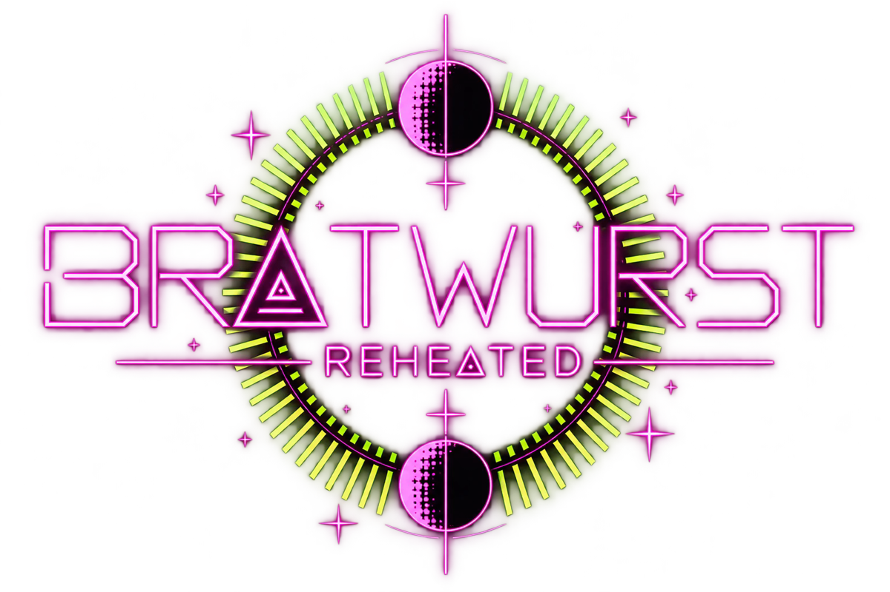

  

# Bratwurst Reheated

A fan remake of the Amiga shooter **Bratwurst**, built in GameMaker Studio 1.4 as a stand-alone Windows game. Float, shoot, crash and repeat, with one to four players, keyboard and Xbox controllers, and a terminal-style look with 30 colour themes.

The goal is to keep the feel and the physics of the original wherever it can be verified, and then grow it with new maps, game modes, ships, weapons and music.

## What's new

<!-- UPDATES:START -->

### UPDATE 42 - 2026-10-18 - LCD countdown

- The Race countdown (3, 2, 1, GO!) is now drawn like a digital LCD display with straight segments and no rounded corners.

### UPDATE 41 - 2026-10-18 - Sliding along walls

- Ships no longer get stuck on walls. When you hit a wall you now slide along it and slow down. The more the nose points into the wall, the more you slow down, and you can turn away and keep flying.
- Sparks fly from the ship while it scrapes along a wall.
- Wall damage now depends on how hard you hit the wall head-on, so scraping along a wall hardly hurts.

### UPDATE 40 - 2026-10-18 - Race maps and countdown

- Race now only lists maps that were saved with Race ticked in the map editor. If there are none, the map row says NO RACE MAPS and START is locked. New maps start as Classic and Galaxy Duel only. Older maps without a finish box lose their Race mark once.
- The 3, 2, 1, GO! countdown is drawn with sharp vector lines instead of a stretched font.

### UPDATE 39 - 2026-10-18 - Map editor tools

- The map editor tool panel is tidier: smaller text and the tools are split into STATUS, DRAW, PLACE, VIEW and FILE, each in its own colour. The active tool is highlighted and the help line at the bottom follows the tool.
- Zoom in and out with the mouse wheel (it zooms around the mouse pointer). Hold SPACE and drag with the mouse (or drag with the middle button) to move around when zoomed in. HOME resets the view.
- Over the finish box the wheel still turns the arrows.

### UPDATE 38 - 2026-10-18 - Race countdown

- Race starts with a big countdown in the middle of the screen: 3, 2, 1, GO! You cannot thrust until GO!, and the race time starts then.
- Fullscreen: the Windows key no longer makes the game flicker out and back in. Alt+Tab still leaves fullscreen right away.

### UPDATE 37 - 2026-10-18 - Race positions and results

- Race position: the panel shows POS x / N. It depends on finished ships, laps, who crossed the finish box first and the start order.
- Pickups now depend on your position: the leader only gets a plasma shot, the middle gets plasma or a missile, and last place gets a guided missile or drift fuel.
- Ships that have finished fly on as ghosts: they cannot shoot, collide or be hit.
- When only one racer is left, it has 4 seconds to finish (ELIMINATED IN 4, 3, 2, 1) or its ship explodes.
- Race result screen with the winner, places and times, and PRESS TO ENTER NEXT RACE. The winner gets a round win.

### UPDATE 36 - 2026-10-18 - Race pickups

- Race pickups: round orange balls on the course. Fly into one to get a single plasma shot, a missile, a guided missile or a full drift fuel meter. The weapon is selected for you. The ball comes back after 5 seconds.
- Map editor: new tool O places, moves and (with X) removes pickup points, up to 16 per map.
- For now the pickup you get is random. Soon it will depend on your race position.

### UPDATE 35 - 2026-10-18 - Race weapons

- In Race everyone starts with no ammo and no drift. The cannon uses one ammo per shot, and drift fuel does not recharge on its own.
- Weapons no longer damage or kill in Race. A hit makes the ship 80% slower for 3 seconds (a new hit restarts the time). The player panel shows the slow time as SL.
- Pickups that give ammo and drift are still to come.

### UPDATE 34 - 2026-10-18 - Race (first part)

- New game mode: RACE. Pick laps, map, rounds and powerups (off by default) in the menu. The player panel shows your lap and the top bar shows the race time.
- Map editor: new tool F draws a start/finish box. The box has arrows for the racing direction (turn them with the mouse wheel), and ships fly straight through it. Cross it in the arrow direction to finish a lap. Race maps without a finish box show a warning.
- Hitting a wall no longer damages your ship in Race.
- Race is not finished yet: no pickups or weapon rules and no race results screen.

### UPDATE 33 - 2026-10-18 - Drifting fuel

- Drifting now uses fuel. A full meter gives 8 seconds of drift. Fuel is only used while you drift, and what is left is kept for later.
- When the meter is empty it recharges in exactly 6 seconds, and you cannot drift until it is full.
- The player panel shows the meter as AB (blue, red while recharging) instead of RF LOCKED.
- The length can be changed in the hidden Powerup Editor (P in Options) under DRIFT: DRIFTING FUEL.

### UPDATE 32 - 2026-10-18 - Galaxy Duel

- Astro Duel is now called GALAXY DUEL.
- A hit no longer kills right away. The first hit damages your ship for 6 seconds: it is 60% slower and you cannot use any weapons, only steer and thrust. Sparks fly from the ship and little pieces fall off. After 6 seconds it is repaired and works like new.
- If you are hit while damaged, your ship explodes.

### UPDATE 31 - 2026-10-16 - Alt-tab in fullscreen

- Another fix for the window disappearing when you alt-tab out of FULLSCREEN: the game now leaves fullscreen as soon as you press Alt+Tab or the Windows key, and returns when you come back.

### UPDATE 30 - 2026-10-16 - Title screen credits

- The title screen has a credits line at the bottom: Bratwurst (1995) originally fried by Three Little Elks (3LE) and Reheated (2026) by Thermoptic.
- The ESC = QUIT text is gone from the title screen.

### UPDATE 29 - 2026-10-15 - Pause menu music

- The pause menu now lets you change song with LB / RB.
- The pause menu only shows gamepad controls (the keyboard list is gone).
- Options: WINDOW is renamed SCREEN MODE.

### UPDATE 28 - 2026-10-15 - Cleaner options

- Options: WIDE PLAYFIELD is gone (the playfield is always wide). SCANLINES and PHOSPHOR GLOW are now one switch: SCANLINES AND GLOW.
- The MUSIC on/off row is gone. VOLUME now goes down to 0%, shown as OFF, which turns the music off.
- The DATA box in the main menu shows the description right at the top, without the INFO heading.

### UPDATE 27 - 2026-10-15 - Asteroids, zoom and polish

- New game mode: ASTEROIDS. Waves of rocks fly in from the edges; shoot them and they split into smaller, faster ones. Options has a LEVEL setting (1 to 5, default 3) where every level doubles everything.
- New option ZOOM (1 to 10): 1 is the normal camera, 10 shows twice as much of the arena. It changes smoothly and works in every game mode.
- A seventh song: Juke to Jupiter. The music fades in when the game starts.
- The music player buttons are lined up (plus and minus in line with play/pause, MUTE under next). Panels get corner brackets.
- Title screen says PRESS START TO TURN UP THE HEAT.
- Alt-tab from fullscreen no longer makes the window disappear.
- Your own shots no longer hit you when you fire straight ahead at full speed.

### UPDATE 26 - 2026-10-14 - Smaller music files

- The five songs are re-encoded at a slightly lower quality, so the game is about 4 MB smaller (the music is about 15 MB instead of 19 MB). Length and the equalizer are unchanged.

### UPDATE 25 - 2026-10-14 - Music player in the main menu

- The right side of the main menu is now two boxes: DATA on top and a MUSIC player below it. The player has the spectrum, the song name and number, a timeline with elapsed and remaining time, previous / play-pause / next buttons, shuffle, repeat, volume (minus, LED bar, plus), a MUTE button and the next track at the bottom.
- Everything in the player can be clicked with the mouse; click the timeline to seek. LB / RB change song, Y (or M on the keyboard) plays and pauses.
- Songs no longer loop forever: when a song ends the next one starts (shuffle picks a random one, repeat plays the same). The title song still loops on the title screen.
- The Palette and Files boxes are gone to make room.

### UPDATE 24 - 2026-10-14 - Navigation dots, safer shots

- Navigation dots: a fixed grid of coloured pixels, 100 pixels apart, covers the whole arena so you can tell where you are and how fast you move when nothing else is in view. They only show when the camera is zoomed in and fade out completely when it zooms out.
- Shots and missiles now get the forward speed of your ship on top of their own speed (in the direction you fire), so a fast ship at full speed can no longer fly into its own shots. They still go exactly where the nose points.
- Solid colors: the fill now covers the whole hull, with no thin edge next to the outline.

### UPDATE 23 - 2026-10-14 - Solid colors, side thruster, B to go back

- New option SOLID COLORS (Options, OFF by default): fills all solid walls and the ships with their colour.
- Drift: new SIDE THRUSTER setting (secret Powerup Editor, DRIFT page). While you drift, thrust and turn, a side thruster pushes the ship out of the curve (turn right = pushed left, turn left = pushed right), like a rally car sliding through a corner.
- B on the gamepad goes back one step on the ship select screen (and back to the menu from the first row).
- Fixed a crash when the camera zoomed after a ship was destroyed.

### UPDATE 22 - 2026-10-14 - New icon, Dracula theme

- The game has a new icon: the BW logo with the equalizer ring.
- Dracula is now the default theme. A theme you pick is still saved and used next time.
- The debug text in the top left of the play area is hidden by default. Press F1 to show it.

### UPDATE 21 - 2026-10-14 - Options in the pause menu, drift settings

- The pause menu has a new OPTIONS entry. It opens the normal options menu on top of the match, so you can change theme, volume and so on while you play. Esc goes back to the pause menu.
- The secret Powerup Editor (Options, press P) has a new DRIFT page with every setting for drifting and reversing: start speed, turn boost, slide angle, drift thrust, reverse thrust, trail length, engine sound and trail width.

### UPDATE 20 - 2026-10-14 - Smooth camera zoom

- When a player dies (or comes back after respawning) the camera no longer jumps straight to the players that are left. It zooms and moves smoothly, in about a second.

### UPDATE 19 - 2026-10-14 - Railgun

- New powerup: RAILGUN. Pick it up and hold the powerup button (B) for 4 seconds. A glowing ball grows in front of the ship and turns white when it is charged. Let go to fire: a beam in your colour shoots through the whole map, over every wall and object, reaches the other side in half a second, stays for 2 seconds and fades out in 1. It kills a ship in one hit.
- Sounds: a wobbling charge-up sound that grows stronger and higher while you charge, a ready sound when the Railgun is charged, and a powerful sci-fi laser sound when it fires. Hold the button for 3 seconds after it is charged and it fires by itself. Let go too early and nothing is fired.
- The Powerup Editor has a Railgun page with charge time, beam speed, hold and fade time, beam width, damage, camera shake and ball size.
- The title song now keeps playing when you go from the title screen to the main menu.

### UPDATE 18 - 2026-10-14 - Powerups: Mini Nuke

- New powerup system. A rotating, colour-cycling orb with an icon appears on the map 5 seconds after a round starts, on a random spot away from walls and objects. Fly into it to pick up the powerup. A new one appears 10 seconds after one is picked up.
- First powerup: MINI NUKE. Press B on the gamepad to fire it: a big glowing projectile that explodes with a growing shockwave, a cloud of pixel particles and a camera shake.
- Game modes: new POWERUPS ON/OFF setting for Classic and Astro Duel (default ON).
- Secret Powerup Editor: open Options and press P. Set projectile size, speed, shockwave radius, particles, damage and camera shake for every powerup.
- Music: the title song (3LE - Das Bratwurst, DnB edit) now plays on the title screen only. Menus and matches play the other songs.
- Gamepad: Y fires the special weapon, B fires the powerup, Back switches special weapon. The button that cycled the number of players is gone.
- New pause menu with match stats and a list of all controls.

### UPDATE 17 - 2026-10-14 - Sausage, drift sound, round win text

- A wireframe sausage (for the future Capture the Bratwurst mode) now drifts and rotates in the background of the title screen and menu together with the ships. The model is drawn as an SVG that you can edit yourself (assets/models).
- Drift has its own sound: a looping spaceship engine that plays as long as you drift.
- When a round is won the screen says WELL HOT DOG, WE HAVE A WEINER! with the winning player underneath.
- New LIFE setting for Classic (1 to 6 lives, 6 is the default and the maximum).
- The outer line of the arena frame is gone on all maps (your own maps are updated automatically, with a backup).
- Ship select: PRESS FIRE TO JOIN blinks on every open slot.

### UPDATE 16 - 2026-10-14 - New pause menu, new gamepad layout

- New pause menu: a compact PAUSED box in the middle, a MATCH STATS box on the left (mode, round, map, song, time, players, leader, and for every player the ship, wins, lives and energy) and a CONTROLS box on the right that lists what every button does.
- Gamepad: Special weapon is now on Y, Next special weapon on Back. The "cycle number of players" button is gone (join players on the ship select screen or choose Players in the menu).

### UPDATE 15 - 2026-10-14 - Glowing missiles, shots go where you aim

- All missiles are now a glowing ball with a solid core that pulses and flickers, with small pixel particles flying out behind it.
- Shots and missiles always fire exactly in the direction the ship is pointing, even when you drift or slide sideways at full speed. They no longer inherit the speed of your ship.

### UPDATE 14 - 2026-10-14 - Drift light trails

- Drifting now leaves light trails behind the ship in the colour of the ship: two trails for wide ships, one for narrow ones. The trails grow out as you start to drift, follow the path you move along and fade out towards the tail. When you stop drifting the whole trail fades away.
- A glowing ball sits where each trail starts, to show that the engine is working: a solid core with a soft glow that pulses and flickers.
- Drift slides more to the side and has stronger thrust. The trails are thinner and half as long, and the trail keeps hanging on the ship while it fades out when you let go of the drift button.

### UPDATE 13 - 2026-10-14 - Pause menu, drift and reverse

- Pause menu: press Esc or Start during a match for Resume Game and Quit to Menu. The game stands still while it is open.
- Drifting (new, experimental): hold the left trigger while you thrust to slide sideways. Faster turning, thrust pushed outwards from the turn, sparks behind the ship. It only works while you thrust and move. Special weapon switch moved from the left trigger to Y.
- Reverse: press only the left trigger (no thrust) to back the ship up very slowly, for example out of a wall.
- Missile explosions are 30 percent bigger when the missile hits a wall or a player.
- Ship select: every open slot shows a smaller, centred PRESS FIRE TO JOIN, also slot 4.
- Music: five Thermoptic tracks added to the playlist, music plays during matches (a new random song every round, shown in the top bar), and a Volume setting in Options (10 to 100 percent, default 70).

### UPDATE 12 - 2026-10-14 - Music playlist, camera lock

- The main menu shows NOW PLAYING with the name of the current song under the spectrum. Press LB / RB on a gamepad (or PageUp / PageDown) on the title screen, in the menu or on ship select to switch song.
- Six songs in the playlist: 3LE - Das Bratwurst (DnB edit, played on the title screen only) and five Thermoptic tracks (No Safe Orbit, Sectorwurst, We Were Never Organic - Disco Edit, Nothing Good Beyond Neptune, The Final Frankfurter). The spectrum follows each song, and long titles scroll.
- Music now plays during matches too: a random song starts every round and its name is shown in the top bar. New Volume setting in Options (10 to 100 percent, default 70).
- When only one player is left the camera stays where it is instead of zooming in on the winner.
- The map name is part of the header line during a match.

### UPDATE 11 - 2026-10-14 - Ship select redesign, respawn countdown, bigger explosions

- New ship select screen: every player pane is divided into a step strip, a numbered row list, weapon chips, a framed rotating ship with radar rings, and stat bars (speed, energy, turn, ammo, rate). Up/Down changes the row, Left/Right changes the value.
- Respawn: after losing a life the ship waits 3 seconds. The player panel shows 3, 2, 1 and then the ship spawns as usual.
- Missile explosions are twice as big, with a large cloud of pixel particles. The expanding ring now hurts ships it reaches: 3 energy, once per explosion (Classic).
- Sparks when ships crash into each other and when shots hit walls. Ramming a ship now pushes and slightly twists it depending on speed and where you hit, and ships that overlap are pushed apart so they cannot get stuck.
- Map editor: Load Map window (L) with a table of which game modes each map is made for.
- The main menu shows a picture of the selected map on the MAP row. The map name is shown in the header while you play.

### UPDATE 10 - 2026-10-14 - Maps per game mode, menu spectrum

- Map editor save window: type a name (or press Generate name for a random star-and-sausage name) and tick the game modes where the map should be available.
- The map list in each game mode only shows the maps made for that mode. Classic and Astro Duel now have their own map choice.
- Rotate a start position in the map editor with the mouse wheel.
- The main menu has the same background as the title screen: grid, twinkling stars and drifting ships.
- New spectrum visualizer in the menu: 32 bars, falling peaks, a mirror image, an oscilloscope line and a short history strip. It follows the music and uses the colours of the selected theme.
- After the last opponent is destroyed there are 4 more seconds of play before the round result appears.

### UPDATE 9 - 2026-10-13 - New title screen, no gravity

- New title screen: a centred line logo, a circular equalizer ring around it that dances to the music, pulsing planets, twinkling stars and the drifting ships in the background.
- Ships no longer sink when you let go of the controls. A ship you are not steering stands completely still.

### UPDATE 8 - 2026-10-13 - Astro Duel

- New game mode: ASTRO DUEL. Every hit costs a life (default 1 life, so one hit kills). Choose 1-9 lives.
- No damage from crashing into walls.
- Only 3 shots, then a 4 second reload. Fire them as fast or as slow as you like.
- Bigger projectiles (30 percent) that are easier to hit with.
- Only Missile (twice as fast) and Turbo Boost, for every ship.

### UPDATE 7 - 2026-10-13 - Explosions and sparks

- Ships explode when they lose a life: pixel particles in all directions plus five pieces of the hull that spin away and fade out.
- Sparks fly when a ship is hit and when it crashes into a wall. The harder the crash, the more sparks.
- Fixed shots and missiles that could fly straight through thin walls.

### UPDATE 6 - 2026-10-13 - Music and sound

- The seven sound effects from the Amiga original are in the game: cannon, missile, guided missile, explosion, wall crash, ship against ship and cannon hit.
- Title music and a live equalizer on the title screen and in the menu.
- Options: music and sound effects can be switched on and off.

### UPDATE 5 - 2026-10-13 - Rounds and game modes

- Rounds: play several rounds in a match (default 3). The last ship flying wins a round.
- Results screen after the last round with rematch or main menu. A rematch lets you pick new ships.
- Game Modes menu with Classic and Astro Duel. Astro Duel is playable, Race and Capture the Bratwurst are on the way.

### UPDATE 4 - 2026-10-13 - Maps and map editor

- Three maps: the original arena (Sirius Bratwurst) and two remixes (Kepler Chorizo, Proxima Merguez). Pick the map in the menu.
- Map editor: draw solid walls and boxes with the mouse, place start positions and save your own maps. New maps get a random name (a star or planet plus a sausage).
- Every wall object has its own colour from the colour theme.

### UPDATE 3 - 2026-10-13 - Ships and weapons

- Ships can collide with each other and knock each other away. A boosting ship hits much harder.
- Every player has a unique colour from the theme, on the ship and on the player panel.
- Switch special weapon and weapon position during a match, with the left trigger (weapon) and left bumper (weapon position).
- Player panels along the bottom of the screen show energy, ammo, lives, special weapon and the weapon position.

### UPDATE 2 - 2026-10-13 - Terminal look

- New menus in a terminal style: title screen, main menu, ship select and the match screen.
- 30 dark colour themes (Base16) and a choice of accent colour. Settings are saved in files next to the game.
- Sharp text at every resolution, a wide playfield option, scanlines and glow.
- Players can join on the ship select screen, up to four.

### UPDATE 1 - 2026-10-13 - First playable version

- Vector ships drawn from the 15 original ship files, with the original movement, shooting, arena, camera zoom and crashes.
- One to four players with keyboard and Xbox controllers.
- Special weapons: Missile, Guided Missile, Turbo Boost, Tractor Beam and Cannon Turret.
- Ship select with weapon and weapon position.

<!-- UPDATES:END -->

*The same list ships with the game as `updates.txt` (Included Files).*

## Play

- Open `gms/Bratwurst.gmx/Bratwurst.project.gmx` in GameMaker Studio 1.4 and press F5.
- Controls and settings are described in [`gms/README.md`](gms/README.md). Placeholder keys: player 1 arrows + space, player 2 WASD + left shift, player 3 IJKL, any Xbox controller.
- Settings, colour themes and maps are saved as `.ini` files in the game's save folder (the path is shown under Options, Data folder).

## About this repository

- [`CHANGELOG.md`](CHANGELOG.md) is the detailed technical log; the list above covers the big features.
- [`docs/`](docs/) holds the research and decisions (in Swedish): how the original works, what is verified and what is not, and the test plan.
- `tools/` has the scripts that extract and convert data from the original and generate game data.
- The original game files are **not** included in this repository. Some game data derived from the original (ship shapes, the original arena, sound effects) is, so the repository is private until the rights question is settled (see [`docs/09_RIGHTS_AND_PROVENANCE.md`](docs/09_RIGHTS_AND_PROVENANCE.md)).
